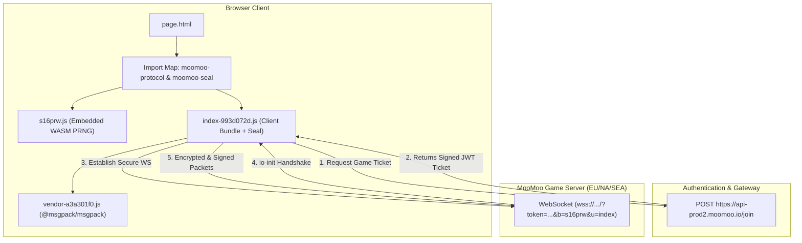

# MooMoo.io Protocol Dump & Security Reverse Engineering

A complete breakdown, deobfuscation, and wire protocol analysis of **[MooMoo.io](https://moomoo.io)** (Version 1.9.4 / Build `s16prw`).

This repository contains extracted raw bundles, deobfuscated security primitives, the full network capture (`dump.har`), and a standalone Node.js packet decoder.

---

## Table of Contents
- [Architecture Overview](#architecture-overview)
- [Repository Structure](#repository-structure)
- [Anti-Tamper & Security Analysis](#anti-tamper--security-analysis)
  - [1. WebAssembly Byte-Mixer (`s16prw`)](#1-webassembly-byte-mixer-s16prw)
  - [2. Self-Bundle Integrity Check](#2-self-bundle-integrity-check)
  - [3. Function Hook / Monkeypatch Detection](#3-function-hook--monkeypatch-detection)
  - [4. Dynamic Opcode Permutation](#4-dynamic-opcode-permutation)
- [WebSocket Wire Protocol](#websocket-wire-protocol)
  - [Framing & Encryption Flow](#framing--encryption-flow)
  - [Decoded Live Traffic Sample](#decoded-live-traffic-sample)
- [Quick Start](#quick-start)

---

## Architecture Overview



---

## Repository Structure

```
├── dump/
│   └── dump.har                  # Full 23.4 MB HTTP/WebSocket network capture
├── raw/
│   ├── page.html                 # Original SPA container & importmaps
│   ├── s16prw.js                 # Original obfuscated protocol module
│   ├── index-993d072d.js         # Original game bundle (Vite + RC4 obfuscated)
│   └── vendor-a3a301f0.js        # Original vendor bundle (MessagePack)
├── src/
│   ├── protocol/
│   │   ├── moomoo-protocol.js    # Deobfuscated & annotated WASM byte mixer
│   │   ├── moomoo-seal.js        # Deobfuscated & annotated anti-tamper engine
│   │   ├── opcode-tables.js      # Mulberry32 + FNV-1a opcode generator
│   │   └── crypto-primitives.js  # Xorshift32 stream cipher & HMAC-SHA256
│   └── tools/
│       └── decode-capture.mjs    # Standalone WebSocket packet decoder
├── package.json
└── README.md
```

---

## Anti-Tamper & Security Analysis

MooMoo.io implements a multi-layer defense layer called **"Seal"** designed to block unauthorized bots and automation scripts.

### 1. WebAssembly Byte-Mixer (`s16prw`)
- **Module**: `src/protocol/moomoo-protocol.js`
- **Constants**:
  - `BUILD_ID = "s16prw"`
  - `BUILD_SALT = 2988461847` (`0xB227C097`)
- **Mechanism**:
  Embeds a 163-byte WebAssembly binary exporting function `m(seed, index)`. When connecting, the server sends a 32-bit random timestamp `seedA` and a 16-byte hex `salt`. The client computes:
  $$\text{masterKey}[i] = \text{salt}[i] \oplus m(\text{seedA} \mid 0, i)$$

### 2. Self-Bundle Integrity Check
During startup, an asynchronous self-inspection routine fetches its own bundle script:
```javascript
const res = await fetch(import.meta.url);
const buf = await res.arrayBuffer();
const digest = new Uint8Array(await crypto.subtle.digest("SHA-256", buf)).subarray(0, 16);
```
If an attacker uses DevTools Local Overrides or replaces the bundle, `digest` changes.

### 3. Function Hook / Monkeypatch Detection
The client validates that critical methods (such as `socket.send` and `socket.connect`) have not been wrapped by Tampermonkey or userscripts:
```javascript
function verifyFunctionIntegrity(functionsToVerify) {
    const isUntampered = functionsToVerify.every(fn => {
        return bundleText.indexOf(Function.prototype.toString.call(fn)) !== -1;
    });

    for (let i = 0; i < sealKey.length; i++) {
        sealKey[i] ^= bundleDigest[i] ^ (isUntampered ? 0 : 165);
    }
    return sealKey;
}
```
If a hooked function is detected, `isUntampered` evaluates to false, applying an offset of `165` to the key. This corrupts all outgoing packet tags and causes the server to immediately disconnect the socket.

### 4. Dynamic Opcode Permutation
Instead of static action strings (such as `"sp"` or `"2"`), action opcodes are scrambled per connection:
- **Client Opcodes (22 actions)**: `["M", "D", "9", "e", "F", "z", "H", "K", "L", "N", "b", "P", "Q", "c", "6", "S", "0", "T", "R", "A", "V", "I"]`
- **Server Opcodes (42 events)**: `["A", "B", "C", "D", "E", "a", "G", "H", "I", "J", "K", "L", "M", "N", "O", "P", "Q", "R", "S", "T", "U", "V", "X", "Y", "Z", "g", "1", "2", "3", "4", "5", "6", "7", "8", "9", "0", "W", "F", "p", "q", "r", "m"]`
- **Shuffle**: Driven by **Mulberry32 PRNG** seeded with:
  $$\text{seed} = (\text{seedA} \oplus (\text{BUILD\_SALT} \times 2654435761)) \gg 0$$

---

## WebSocket Wire Protocol

### Framing & Encryption Flow

#### Client-to-Server (`c2s`) Frame
```
+--------------------+---------------------------------------------------+
| HMAC-SHA256 (6 B)  | Xorshift32 Payload: MessagePack [opcode, args, seq] |
+--------------------+---------------------------------------------------+
```
1. Serialize payload: `MessagePack([scrambledOpcode, args, sequenceNumber])`.
2. Compute 6-byte HMAC: `tag = HMAC_SHA256(masterKey, payload)[0..5]`.
3. Mix keystream seed: `seed = (mask_c2s ^ readUint32LE(tag, 0)) >>> 0`.
4. Encrypt payload in place using 32-bit Xorshift PRNG.

#### Server-to-Client (`s2c`) Frame
```
+------------------------------------------------------------------------+
| Xorshift32 Payload: MessagePack [scrambledOpcode, eventData]           |
+------------------------------------------------------------------------+
```
1. Derive packet seed: `seed = (mask_s2c ^ (receivedCount * 2654435761)) >>> 0`.
2. Decrypt in place using 32-bit Xorshift PRNG.
3. Deserialize MessagePack and map scrambled opcode back to string event.

---

### Decoded Live Traffic Sample

Captured from `wss://mem-dbxzm-tqmwl.eu.moomoo.io/`:

```
📥 [RECV] [Frame 0] HANDSHAKE: io-init
   Socket ID : W0WlPvwcWk
   Seed A    : 469671315
   Salt Hex  : 2c897339b998a42dbb4976682f034238
   Master Key: d1c68d785a6a2a7070f0b5aa10e89c4f

📤 [SEND] [Frame 1] Opcode: '0' (id=14, seq=1) -> Keepalive Ping
📤 [SEND] [Frame 2] Opcode: 'M' (id=18, seq=2) -> Spawn Player:
   Args: [{"name":"zck","moofoll":null,"skin":4,"anon":0}]

📥 [RECV] [Frame 3] Opcode: 'A' (id=31) -> Clan Roster & Animal Data
📥 [RECV] [Frame 5] Opcode: 'C' (id=23) -> Assigned Player SID: [2]
📥 [RECV] [Frame 6] Opcode: 'D' (id=36) -> Spawn Confirm:
   Payload: [["W0WlPvwcWk", 2, "zck", x: 3027, y: 5662, hp: 100/100, skin: 4], true]

📤 [SEND] [Frame 10] Opcode: 'D' (id=1, seq=3) -> Mouse Aim Angle: [-2.44] rad
📥 [RECV] [Frame 11] Opcode: 'a' (id=3) -> Spatial Sync: Player 2 at (3027, 5662)
```

---

## Quick Start

### 1. Requirements
- Node.js v18+ (tested on Node v24)

### 2. Run Captured Packet Decoder
```bash
# Decrypt all WebSocket packets inside dump/dump.har
node src/tools/decode-capture.mjs
```

---

## License
MIT
